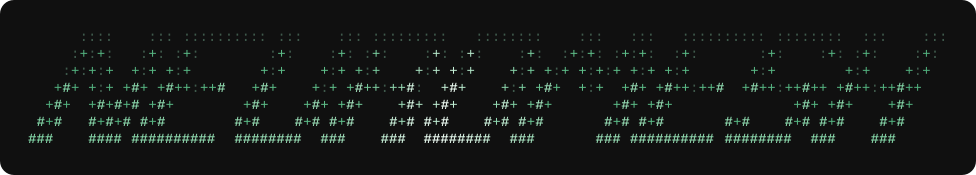
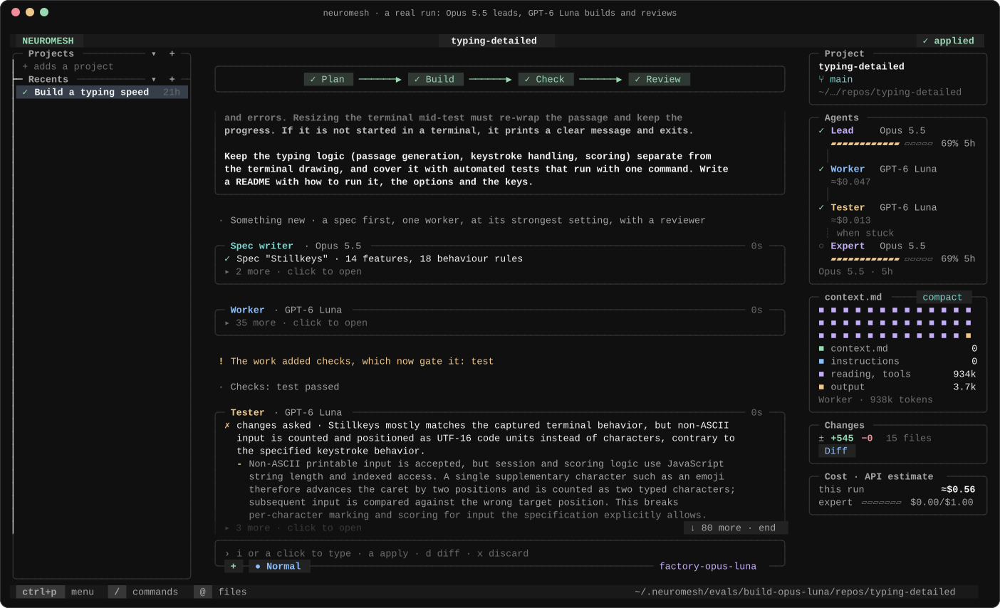
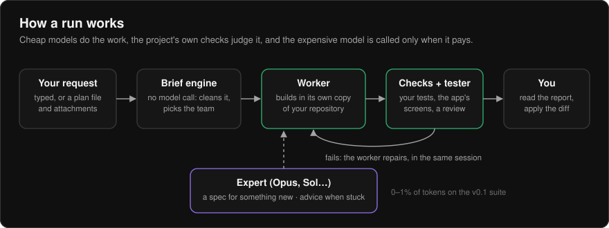

<p align="center">
  
</p>

<p align="center">
  <b>Opus-level coding results on a $20 Claude plan.</b><br>
  Cheap models build. Your project's own checks judge. The expensive model only plans and advises, and only when it pays.
</p>

<p align="center">
  
  
  
  
  <a href="https://github.com/farhanakhtar0x66/neuromesh/actions/workflows/ci.yml"></a>
</p>

<p align="center">
  
</p>

---

## Why

A frontier model used for every step builds good software and runs out of
your plan by Wednesday. Most of those steps don't need it.

Neuromesh runs a **cascade** on the Claude plan you already have:

| Tier | Model | Does |
| --- | --- | --- |
| 0 | none: Neuromesh's own rules | picks where a request starts, in 0 ms, with no model call |
| 1 grunt | Haiku 5.5, low | mechanical edits and text transforms, in one call with no tools |
| 2 worker | Haiku 5.5, medium then high | routine building; says up front when a task is beyond it |
| 3 senior | Sonnet 5.5 | work that needs judgement, and reviews |
| 4 expert | Opus 5.5, medium | plans and advises; **builds nothing** |

- **Every result is checked, not trusted.** Your project's tests and type-check
  run on every change; a stuck task climbs a tier instead of guessing.
- **Opus is spent where it pays:** a plan for a large request, or advice when
  Sonnet is stuck, within a per-run limit.
- **You approve.** Work happens in its own git worktree (sandboxed on macOS).
  Nothing touches your repository until you've read the report and applied the
  diff.

## Results

The routing benchmark: 15 prompts in five groups with three traps, plus a
held-out 15 the router was never tuned on. Each answer is graded by checkers
that run the code. Costs are **estimates** at API list prices; the window is
the Claude plan's five-hour limit. Full write-up:
[evals/routing-bench/REPORT.md](evals/routing-bench/REPORT.md).

| | Quality (of 150) | Est. cost | Five-hour window |
| --- | --- | --- | --- |
| **Opus 5.5 alone**, 2 runs | 150.0, 147.9 | $3.32, $3.87 | 13%, 21% |
| **`cascade-claude`**, 4 runs | 150.0, 147.9, 146.7, 147.8 | $0.69 to $0.84 | 3% to 6% |
| **Haiku 5.5 alone**, 1 run | 142.0 | $0.21 | 2% |
| *Held-out 15:* Opus alone | 150.0 | $6.90 | 38% |
| *Held-out 15:* `cascade-claude` | 150.0 | $1.22 | 9% |

Paired over three cascade and two Opus runs, the mean difference is −0.5
points (90% interval −1.2 to +0.1): **not worse than Opus alone, for about a
fifth of the cost and a quarter to a third of the window.**

> **What this does not show yet.** These prompts are too easy to separate the
> configurations: Haiku alone is close behind, and on our first ten real tasks
> from real commits it passed all ten. So the claim today is "matches Opus for
> far less", not "beats it". The beta's job is the harder suite that can tell
> (see [Roadmap](#roadmap)). Results from the earlier GPT-6 Luna teams are in
> [docs/08-build-test.md](docs/08-build-test.md).

## Install

Node.js 24 or newer, git, and [Claude Code](https://claude.com/claude-code)
signed in to a Claude plan:

```sh
curl -fsSL https://raw.githubusercontent.com/farhanakhtar0x66/neuromesh/neuromesh-testing/install.sh | sh
```

The script keeps a copy in `~/.neuromesh/app` and adds a `neuromesh` command;
run it again to update. Codex, Antigravity and opencode work too, for the other
teams (`/connect` in the app).

**Testing the beta?** Read [TESTING.md](TESTING.md): what to try, how to rate a
run and what gets shared.

## Quick start

```sh
cd your-project
neuromesh
```

Type what you want built. Press Ctrl+P for every command. Prefer the command line?

```sh
neuromesh run "make slugify trim leading and trailing dashes"
neuromesh diff
neuromesh apply
neuromesh rate last 4
```

Try the interface without spending any quota:

```sh
neuromesh tui --preset demo
```

## Teams

| Team | Who | When |
| --- | --- | --- |
| `cascade-claude` (default) | Haiku as grunt and worker, Sonnet as senior and reviewer, Opus as planner and adviser | one Claude plan; the measured one |
| `factory-opus-luna` | Opus 5.5 lead, GPT-6 Luna workers | a Claude plan and a ChatGPT plan |
| `factory-sol-flash` | GPT-6.1 Sol lead, Gemini 3.8 Flash workers | ChatGPT and Gemini plans |

**Custom team** (`/team`) puts any model your tools offer in each place.
`neuromesh presets` lists the rest, including single-model baselines.

## How it works

<p align="center">
  
</p>

- **Tier 0** scores the request (the instruction, not pasted logs), the files
  it names and the subsystems it touches, and picks the starting tier with no
  model call. `neuromesh routing route "<request>"` shows why.
- **Small, self-contained requests are answered in one call with no tools**;
  Neuromesh writes the files and runs the checks. This cuts their input tokens
  by about 94%.
- **A worker or senior that judges a task beyond it stops early** and the task
  climbs, instead of burning a long turn first.
- **Every feature has an id** (F01 to F110). Errors name the feature;
  `--disable <key>` switches it off ([docs/10-features.md](docs/10-features.md)).

More: [the cascade](docs/19-cascade.md) · [the engine](docs/05-engine-as-built.md) ·
[the TUI](docs/11-tui.md) · [status](docs/STATUS.md).

## Roadmap

The goal: **cost as little of your plan as possible while resolving at least as
often as one frontier model alone**, shown with intervals on tasks that can
tell them apart. The full plan, with each phase's budget and gate, is
[docs/22-path-to-the-goal.md](docs/22-path-to-the-goal.md).

**Done**
- [x] The engine: worktrees, checks, resume after a crash or Ctrl-C, a fault
  harness of 1,400 seeded runs with injected failures on every engine change (v0.1).
- [x] The TUI and the testers' build (v0.2).
- [x] The five-tier cascade on one Claude plan, with zero-token routing (F80 to F99).
- [x] A routing benchmark with code-running checkers, a held-out set, and paired
  intervals (`bench --compare`).
- [x] Start-up cost: no-tools answers for small requests (F90, F109).
- [x] Every turn in one record, with where its tokens went (F106, F108).
- [x] Reports that survive the model's formatting slips (F110).

**Now: the beta (to 2026-11-30)**
- [ ] About 40 real tasks from real commits, several repositories and languages,
  hard enough that Haiku alone fails some.
- [ ] Opus alone, the cascade and Haiku alone on them, with intervals; the numbers
  replace the table above.
- [ ] Testers' runs and ratings on real work ([TESTING.md](TESTING.md)).

**Next, with testers' reports as the evidence**
- [ ] Keep or drop each unmeasured feature (F100 to F104 first) on a number.
- [ ] Oracles: a failing test before a bug fix, pinned behaviour before a refactor.
- [ ] Replay: price a policy change from the record, with no live calls.
- [ ] A controller that picks each action by expected cost, not hand-set thresholds.
- [ ] Any model: probe a new model and place it on the ladder with no code change.
- [ ] Less context per task: a repository index, affected tests first.
- [ ] Search where an oracle exists: two cheap tries, the tests choose.
- [ ] A public benchmark of several hundred tasks for a 3-point claim.

## Testing: what you share

The testing build asks once, on first start, whether to share run reports.

- **A report holds:** the preset and models, efforts, turns, tokens, time,
  estimated cost, how the run ended, checks, escalations, features that failed,
  what you asked, the agents' final reports, and your 1–5 rating.
- **It never holds:** your code or diffs, file locations, or who you are; an
  install is a random id.
- **You can read them:** unsent reports wait in `~/.neuromesh/telemetry/outbox`.
- **Turning it off:** `/settings`, `neuromesh telemetry off`, or
  `NEUROMESH_TELEMETRY=off`.

## Limits

- **Beta.** One person's real use and a 30-prompt benchmark so far. F101
  (blind tests) is off by default after an audit found it cost about 7% of
  cascade-claude runs for no confirmed catch; F102 to F104 are on but never
  fired in 285 runs. `neuromesh features` lists them.
- **One plan.** Every tier draws on the same Claude plan, and an interactive
  Claude Code session spends the same windows.
- **Costs are estimates** from API list prices (`src/usage/prices.ts`). Models
  paid per token through opencode cost real money, shown as opencode reports it.
- **Sandboxed on macOS only.** Elsewhere, agents work in a throwaway git
  worktree and you review the diff before applying it.
- **Platforms:** developed on macOS; Linux should work; Windows is untested.

## Contributing

Issues and pull requests are welcome. Read [CONTRIBUTING.md](CONTRIBUTING.md)
first. Run `npm test` and `npx tsc --noEmit` before you send anything.

Branches: `main` is the release; `neuromesh-testing` is what testers install;
`neuromesh-research` is for experiments.

## License

[MIT](LICENSE). Use, change and share Neuromesh for anything, keeping the
copyright notice. The Neuromesh name and logo are not licensed
([NOTICE.md](NOTICE.md)).
