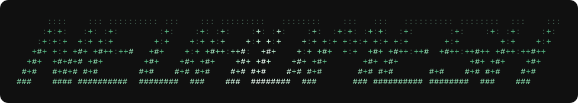
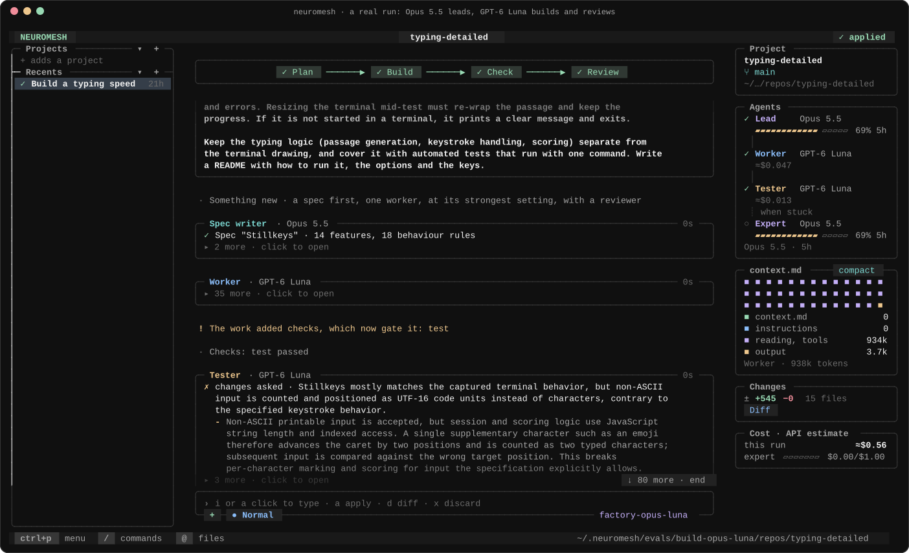
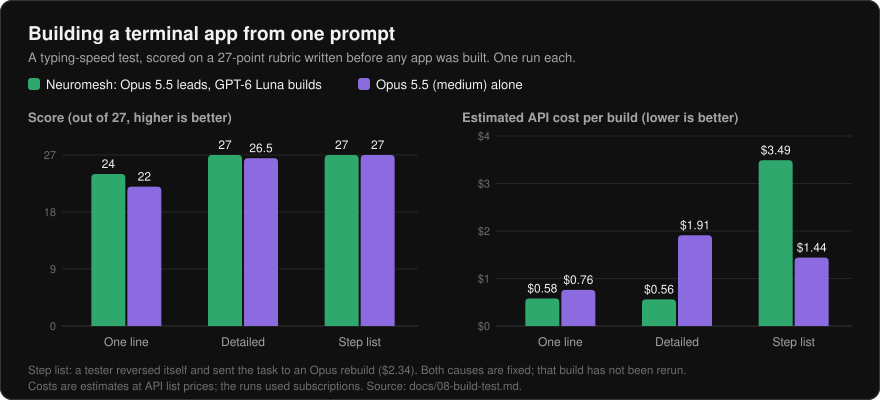
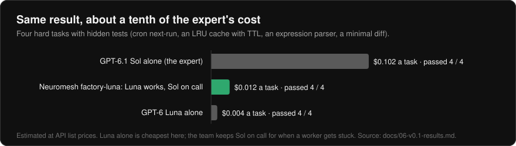
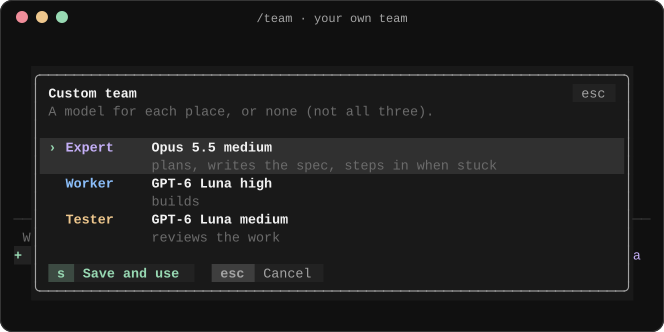
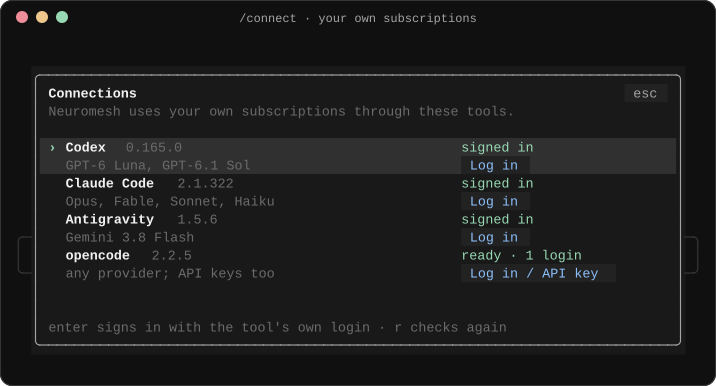
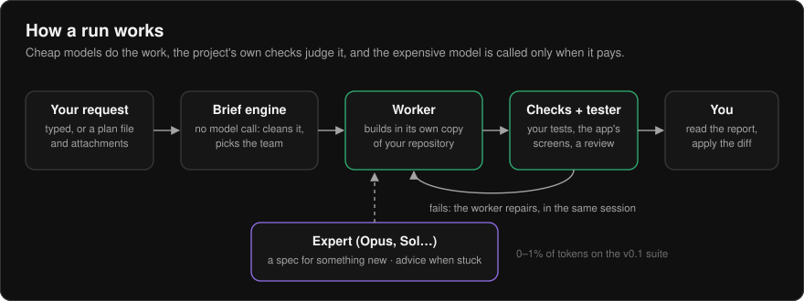

<p align="center">
  
</p>

<p align="center">
  <b>A team of AI coding agents that costs like the cheap model and plans like the expert.</b><br>
  Cheap models build. Your project's own checks judge. The expensive model steps in only when it pays.
</p>

<p align="center">
  
  
  
  
  <a href="https://github.com/farhanakhtar0x66/neuromesh/actions/workflows/ci.yml"></a>
</p>

<p align="center">
  
</p>

---

## Why

A motorcycle assembly line doesn't have its one expert tighten every bolt. Workers
assemble, inspectors check, and the expert steps in when something goes wrong.

Most people use AI coding agents the other way round: the most expensive model
does every tedious step, and its limits run out by Wednesday. **Neuromesh puts
the expert in charge of a team:**

- **Cheap, fast models do the work.** By default that's GPT-6 Luna, through your
  own subscriptions.
- **Every result is checked, not trusted.** Neuromesh runs your project's own
  tests and, for terminal programs, plays the app in a real terminal and hands
  the screens to a reviewer.
- **The expensive model is spent where it pays:** a spec and design for
  something new, advice when a worker is stuck, and a plan only for large
  requests.
- **You approve.** Work happens in its own git worktree, under a write sandbox
  on macOS. Nothing touches your repository until you've read the report and
  applied the diff.

## Results

Measured on subscriptions, with costs estimated at API list prices. The full
write-ups are in [docs/06-v0.1-results.md](docs/06-v0.1-results.md) and
[docs/08-build-test.md](docs/08-build-test.md).

<p align="center">
  
</p>

<p align="center">
  
</p>

- **75 of 75** suite tasks passed across three full runs of the `factory-luna`
  team, with **0 engine failures**. The expert used 0–1% of all tokens.
- A run stopped by a crash or Ctrl-C **resumes** where it stopped and finishes.

> **Read these numbers as early.** The 25-task suite is too easy: GPT-6 Luna
> alone passes all of it, so it can't yet show a team beating one cheap model.
> The build test is one run per configuration. That's why the testing build
> collects real-world reports (see [Testing](#testing-what-you-share)).

## The TUI

Run `neuromesh` in any git repository.

- **Projects and sessions** on the left. Follow-ups continue a session from
  where the last run left off.
- **One box per agent** in the middle, labelled with its role and model.
  Verbosity is none, medium or full; click a box to open it.
- **The pipeline as buttons:** Plan → Build → Check → Review.
- **When the run ends**, the agents' report is drawn as markdown and the stream
  scrolls to its first line.
- **The team as a live graph** on the right, with each model's usage, what its
  context was made of, the changes and the cost.
- **Normal or Turbo.** Normal asks before the lead's plan is carried out and
  before the expensive expert is called. Turbo goes ahead.
- **Mouse everywhere and a key for everything**, in its own `neuromesh-dark`
  theme or transparent over your terminal. It draws only the cells that change
  (about 0.3 ms a frame) and uses nothing when still.

<p align="center">
  
  
</p>

## Install

The testing build, for everyone outside the author's machine (Node.js 24 or
newer, and git):

```sh
curl -fsSL https://raw.githubusercontent.com/farhanakhtar0x66/neuromesh/neuromesh-testing/install.sh | sh
```

The script keeps a copy in `~/.neuromesh/app` and adds a `neuromesh` command;
run it again to update.

Neuromesh uses **your own subscriptions** through the coding tools you already
have: Codex (ChatGPT), Claude Code, Antigravity (Gemini) and opencode. In the
app, `/connect` signs in to each through that tool's own login. opencode also
brings models paid per token through an API key; the key stays with opencode.

## Quick start

```sh
cd your-project
neuromesh
```

Type what you want built. Press Ctrl+P for every command. Prefer the command line?

```sh
neuromesh run "make slugify trim leading and trailing dashes"
neuromesh diff
neuromesh apply
```

Try the interface without spending any quota:

```sh
neuromesh tui --preset demo
```

## Teams

Two favourites cover most work (Ctrl+K):

| Team | Expert | Workers and tester |
| --- | --- | --- |
| `factory-opus-luna` (default) | Claude Opus 5.5, medium: specs, advice, large plans | GPT-6 Luna, low then high effort |
| `factory-sol-flash` | GPT-6.1 Sol, high | Gemini 3.8 Flash |

**Custom team** (`/team`) puts any model your tools offer, or none, in each
place: expert, worker and tester. Every other preset, including the experiments
and single-model baselines, is under **Other presets**.

## How it works

<p align="center">
  
</p>

- **The brief engine** cleans up the request, attaches documents it names, adds
  working standards and picks the team, all without a model call.
- **Workers** start cheap and climb a ladder (low effort, then high) before the
  expert is asked. The expert gives advice first and takes over only if that
  fails.
- **context.md**, a map of the repository built without a model, goes to every
  agent so it explores less. A tool (`nm`) lets any agent look up symbols and
  run checks.
- **Every feature has an id.** Errors name the feature; `--disable <key>`
  switches it off ([docs/10-features.md](docs/10-features.md)).

More: [the engine as built](docs/05-engine-as-built.md) ·
[the TUI](docs/11-tui.md) · [roadmap](docs/09-roadmap.md) ·
[status](docs/STATUS.md).

## Testing: what you share

The testing build asks you once, on first start, whether to share run reports
with the author. They decide which teams become the defaults.

- **A report holds:** the preset and models, efforts, turns, tokens, time,
  estimated cost, how the run ended, checks, escalations, features that failed,
  what you asked, the agents' final reports, and your 1–5 rating.
- **It never holds:** your code or diffs, file locations, or who you are; an
  install is a random id.
- **You can read them:** unsent reports wait in
  `~/.neuromesh/telemetry/outbox`.
- **Turning it off:** `/settings`, `neuromesh telemetry off`, or
  `NEUROMESH_TELEMETRY=off`.

## Limits

- **Sandboxed on macOS only.** On macOS, agents can write only in their run's
  copy of your repository; Codex uses its own sandbox, the others run under
  the system's. On Linux and Windows only Codex is confined; the others work in
  a throwaway git worktree, and you review the diff before applying it.
- **Small benchmarks so far** (see [Results](#results)).
- **Costs are mostly estimates.** On subscriptions, cost is estimated from API
  list prices (`src/usage/prices.ts`). Models paid per token through opencode
  cost real money, shown as opencode reports it.
- **The TUI is new (v0.2).** Most of its use so far has been on the demo preset.
- **Platforms:** developed on macOS; Linux should work; Windows is untested.

## Contributing

Issues and pull requests are welcome. Read [CONTRIBUTING.md](CONTRIBUTING.md)
first: it has the working rules and short contributor terms. Run `npm test` and
`npx tsc --noEmit` before you send anything.

Branches:
- `main` is what has been measured;
- `neuromesh-testing` is what testers run;
- `neuromesh-research` is for experiments.

## License

Source-available under the
[PolyForm Shield License 1.0.0](https://polyformproject.org/licenses/shield/1.0.0).
You may use, change and share Neuromesh for anything except building a product
that competes with it. The Neuromesh name and logo are not licensed
([NOTICE.md](NOTICE.md)).
