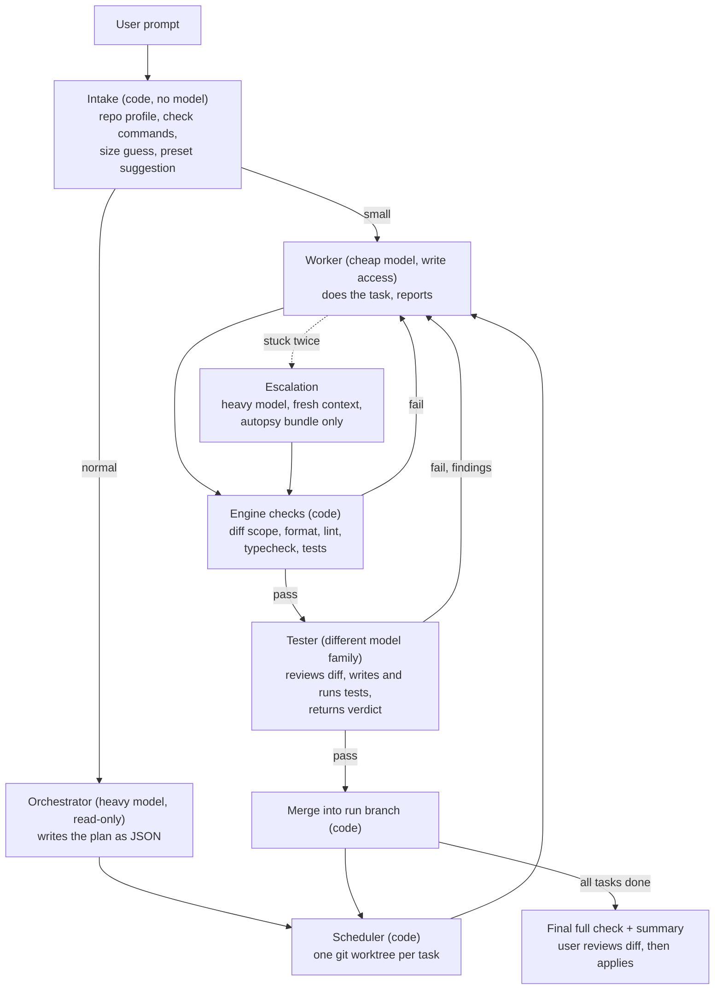

# Engine architecture (v0.1)

Status: the design rationale. For what the code does now, see [05-engine-as-built.md](05-engine-as-built.md). Decisions made with the owner on 2026-11-11:

- Model access: **subscriptions only**, through the Claude Code, Codex and
  Gemini command-line tools already installed. No paid API keys.
- Language: **TypeScript** on Node (26 is installed).
- Proof of "working": a **small task suite** with hidden tests.

- Quota preference (added 2026-11-11): **use Gemini the most, Claude and GPT the
  least.** The Google subscription is mostly unused, so workers, testers and all
  day-to-day development runs go to Gemini first.

## Core philosophy: the factory floor

On a motorcycle assembly line, one expert directs several workers. The workers
do the assembly. The expert steps in only when something goes wrong, and
otherwise saves their energy. Today most people use AI the other way round: the
one expert does every tedious job, which wastes compute and money.

Neuromesh is built to mirror the factory, and every part of the engine maps to
something on that floor:

| Factory | Neuromesh | Rule that follows |
| --- | --- | --- |
| The expert | Orchestrator on the heaviest model | Plans, hands out work, fixes what workers cannot. Never does routine work. |
| The workers | Cheap, fast models (Gemini Flash, or local models) | Do nearly all the reading, writing and running. |
| Quality control | Tester plus the engine's own checks | Nothing leaves the line unchecked. |
| The line itself | The engine (plain code, no model) | Moves work between stations, costs nothing to run. |
| A problem on the line | Escalation | The expert gets a short, exact description of the fault, not the worker's whole story. |

Because the philosophy is "the expert conserves energy", the engine measures
exactly that. **Expert share** is the fraction of a run's tokens spent on the
heaviest model. A single-model run has an expert share of 100%. The lower
Neuromesh gets it while still passing the same tasks, the better it is doing its
job. A setup with one expert on a subscription and every worker on a local model
is the extreme case, and the design must support it.

The long-range target is the one in
`multi_agent_swe_architecture_landscape.md`: the same pass rate as a frontier
model at 15 to 30 percent of its cost. v0.1 is the first working step toward it,
and the research work that document inspired plugs into this engine (see
"Reusing the Rust research" below).

## Five rules the design follows

1. **The engine owns orchestration; the CLI tools own the agent loop.** Each
   role is a complete coding agent (Claude Code, Codex or Gemini CLI) started in
   its documented headless mode. Neuromesh treats it as a black box: a brief
   goes in; a diff on disk, a final structured report and usage numbers come
   out. Streamed events are used for display only, never for control.
2. **The repository is the truth, not the agent's claim.** The engine computes
   the diff with git and runs the checks itself. This costs zero tokens.
3. **The expert sees summaries, not raw material.** The orchestrator reads
   briefs, diff stats, check results and tester findings. It does not read
   worker transcripts.
4. **A team is only called when it pays.** Every agent session has a fixed
   overhead (about 17,500 tokens on Codex last time), so small requests go to a
   single cheap worker with engine checks and nothing else.
5. **Plain files, no ceremony.** A run is a folder of JSON and text files.

## Flow



This matches the v0.01 sketch in `neuromash_architecture_notes.md`: the
"Deterministic Engine" is Intake plus the Scheduler and Checks, and the arrows
between orchestrator, worker and tester are the repair and escalation loops.

## The parts

### Intake (code only in v0.1)

Reads the repository and produces a profile: languages, package manager, the
commands that build, lint, type-check and test it, size, and git state. Guesses
the request size with simple rules and suggests a preset. The user can override.

The notes also imagine a small model that improves the prompt here. In v0.1 the
orchestrator's planning step already turns the prompt into a spec, so a separate
model call is not added until measurements say it would help.

### Orchestrator

Heavy model, read-only access to the repo so it can look around before planning.
It returns a plan that must match a JSON schema (all three CLIs can enforce a
schema on the final answer). Each task in the plan has:

- an id and title
- a brief: objective, files or area in scope, what is out of scope, acceptance
  criteria, how to verify
- dependencies on other tasks
- owned paths (used for the scope check and for safe parallelism)
- an owner: `worker`, or `orchestrator` for tasks it judges too hard to delegate

The planning session is kept and resumed for later questions (a re-plan, the
final summary), so its context is reused from cache rather than rebuilt.

"Does hard tasks": a task owned by the orchestrator, or one that was escalated,
runs on the heavy model in a **fresh** worker-style session. The planning
session stays clean.

### Worker

Cheap fast model with write access inside its own git worktree. It receives the
brief and the repo's conventions, nothing else. It ends with a structured
report: status (`done` or `blocked`), summary, files changed, commands run, open
questions.

### Engine checks

After every worker turn, in code:

- Diff scope: changed paths must fall inside the task's owned paths.
- The project's own format, lint, type-check and test commands.
- A failure signature for each failing check (normalised error text plus the
  set of failing test names), used by the stagnation breaker.

### Tester

A model from a different family than the worker. It reviews the diff against the
acceptance criteria, may add and run tests (only under the repo's test paths;
the engine rejects any other change it makes), and returns a verdict:
`pass` or `fail`, with findings that each name a file, a description and a
command that reproduces the problem.

On `fail`, the findings go back to the same worker session, which still has its
context.

### Repair, stagnation and escalation

- Repair rounds per task: 2 by default.
- **Stagnation breaker:** stop early if the same failure signature appears
  twice, or if the number of passing checks does not go up.
- **Escalation:** reset the task's worktree to its starting point and give the
  heavy model an autopsy bundle: the brief, each attempted diff, and the exact
  failing output each one produced. No worker chat is included, so the heavy
  model is not led down the same wrong path.
- If escalation also fails, the task is marked failed, the run stops cleanly and
  reports what is and is not done.

### Workspace and integration

- The user's working tree is never touched during a run.
- A run has its own branch. Each task gets a worktree branched from it. A task
  that passes is merged into the run branch, and the next task starts from there.
- Parallel work in v0.1: only tasks whose owned paths do not overlap, at most
  two or three at a time. After they merge, the full check runs again. If the
  combination fails, a fix task goes to the heavy model with the failing output.
- At the end the user sees the full diff and applies it with one command.

### Backends

One small adapter per CLI behind one interface:

```ts
interface AgentBackend {
  id: string;
  probe(): Promise<BackendHealth>;          // installed, logged in, version
  run(request: AgentRequest): AgentHandle;  // spawn headless, stream events, cancel
}

interface AgentRequest {
  cwd: string;
  prompt: string;
  model: string;
  effort?: string;
  access: "read-only" | "write";
  outputSchema?: object;
  resumeSessionId?: string;
  timeoutMs: number;
}

interface AgentResult {
  stop: "done" | "quota" | "permission" | "timeout" | "error" | "cancelled";
  finalText: string;
  structured?: unknown;
  sessionId?: string;
  usage: { input?: number; output?: number; cacheRead?: number; cacheWrite?: number };
  logPath: string;
}
```

How each maps. These were proven live in M0; details and caveats are in
[03-m0-results.md](03-m0-results.md).

| Backend | Headless command | Read-only | Write | Schema output | Confined to its folder |
| --- | --- | --- | --- | --- | --- |
| Antigravity (Gemini) | `agy -p --output-format stream-json` | `--mode plan` | `--mode accept-edits` plus a session-only command allow rule | `--json-schema` | no |
| Claude Code | `claude -p --output-format stream-json` | `--permission-mode plan` | `--permission-mode acceptEdits` plus allowed tools | `--json-schema` | no |
| Codex | `codex exec --json` | `-s read-only` | `-s workspace-write` | `--output-schema` | yes |

Gemini CLI is not a backend: Google no longer lets individual accounts use it
and sends them to Antigravity.

Also planned, after v0.1:

- OpenCode (`opencode run --format json`), which is the route to local models.
- A direct API backend where Neuromesh runs its own loop, if API keys are ever
  added.

A **fake backend** that replays scripted results exists already, so engine tests
run without spending quota.

Write access always happens in a disposable worktree, never in the user's
working tree. Only Codex truly confines the agent to that folder. On Antigravity
and Claude Code a worker can reach anything the user can, so the engine relies
on the brief, the diff scope check and review of the final diff. Tightening this
is an open item from M0.

### Presets

Presets are data files. Exact model ids are filled in from what each CLI lists
during M0.

| Preset | Orchestrator (expert) | Worker | Tester | Purpose |
| --- | --- | --- | --- | --- |
| `factory` (default) | Opus 5.5 high (Claude), planning and escalations only | Gemini 3.8 Flash high | Gemini 3.8 Flash, fresh context | The philosophy as a preset. Claude is touched briefly, GPT not at all. |
| `google-only` | Claude Opus 4.6 through Antigravity, or Gemini 3.8 Flash high | Gemini 3.8 Flash | Gemini 3.8 Flash, fresh context | Runs entirely on the Google subscription. Uses no Claude or ChatGPT quota. Also the default for development runs. |
| `trio` | Opus 5.5 high (Claude) | Gemini 3.8 Flash (Gemini) | GPT 6.1 Terra (Codex) | The three-way preset from the notes, tester from a different family |
| `duo` | Heavy | Gemini 3.8 Flash | engine checks only | Cheapest team |
| `local-workers` | Heavy model on a subscription | Local model | Local model or engine checks | One expert, everything else on the user's own machine |
| `solo` | (one heavy model does everything) | | | Baseline: the "monolithic frontier model" |
| `solo-cheap` | (Gemini Flash does everything) | | | Baseline: is a team needed at all? |

Antigravity lists Gemini 3.8 Flash at high, medium and low effort, and nothing
heavier from Gemini. It also lists Claude Opus 4.6 and Sonnet 4.6, so the Google
subscription can supply its own expert.

Local models need no new backend: Codex has a built-in local mode
(`codex exec --oss --local-provider ollama`) and OpenCode can do the same. No
local runner is installed on this Mac yet, so `local-workers` is a stretch goal
for v0.1 rather than a promise.

### Run state and events

```
.neuromesh/runs/<run-id>/
  run.json            current state of the run (what resume reads)
  events.jsonl        append-only event log
  plan.json
  tasks/<task-id>/
    brief.md  report.json  diff.patch  verdict.json  usage.json
    checks/*.log  agent-*.log
```

The engine prints the same events as JSON lines on stdout: run started, intake
done, plan ready, task started, agent activity, checks finished, tester verdict,
repair, escalation, merged, usage updated, paused, finished.

A future TUI is only a reader of this stream. The three graphs in the Signal
Studio design map straight onto it: the task graph from the plan, the waterfall
from task timestamps, the usage chart from usage events.

### Limits, quota and resume

- Every agent call has a time limit; every run has limits on repairs and
  escalations.
- Cancelling kills the whole process group of each agent.
- When a CLI reports a quota or rate limit, the run becomes `paused` instead of
  failing. `neuromesh resume <run-id>` continues from the last finished step.
  This is the single biggest practical fix over the old attempt.

### Measuring cost on subscriptions

Subscriptions do not bill per token, so three things are recorded per role and
per model:

1. Tokens reported by the CLI (input, output, cache read, cache write).
   Anything not reported stays `unknown`.
2. Wall time.
3. An **API-equivalent cost**: reported tokens multiplied by public list prices.
   This is a comparison unit, always labelled as an estimate, never presented as
   money spent.

The headline efficiency number is heavy-model tokens used by the team compared
with the `solo` baseline, with API-equivalent cost alongside it.

## Reusing the Rust research

The research kernel (`research/offline-core` on the `neuromesh-research`
branch) is 7,211 lines of Rust. It can be reused, in two different ways,
because it contains two different kinds of thing.

**1. Decision logic that does not care about the language. Port it.**
The stagnation breaker is about 70 lines of pure logic (`progress.rs`): keep a
set of failed states, stop on a repeat, stop after two attempts with no
improvement. The autopsy bundle, the task-graph admission rules and the
"which set of patches broke the build" diagnosis are the same kind of thing.
These are rewritten in TypeScript inside the engine at M4 with the same rules
and the same test cases. Most of the surrounding Rust is the sealing, hashing
and ledger machinery, which is deliberately left behind.

**2. Code analysis that only understands Rust projects. Plug it in.**
The context slicer (M1) and the public-surface lock (M4, M6) work by parsing
Rust source with tree-sitter and asking rust-analyzer questions. That is real,
working analysis, and rewriting it would be wasted effort. The engine therefore
has an **analyzer plugin** slot:

```ts
interface Analyzer {
  supports(repo: RepoProfile): boolean;
  // A compact packet of exactly the code a task needs, built without a model.
  contextPacket?(task: TaskBrief): Promise<string | undefined>;
  // Did this diff change a public interface it was not allowed to change?
  surfaceCheck?(base: string, diff: string, owned: string[]): Promise<Finding[]>;
}
```

The Rust kernel becomes the first analyzer, run as a separate program the
engine calls when the target repository is Rust. A second analyzer built on
tree-sitter can later bring the same two abilities to TypeScript and Python.

Two honest limits. The kernel today only accepts small Rust crates with no
dependencies and no build script, so it needs widening before it handles real
projects. And an analyzer is switched on by default only after it improves the
task-suite numbers, which is why the suite includes Rust tasks.

## Stack

- Node 26, TypeScript in strict mode, npm. Node runs TypeScript files directly,
  so there is no build step.
- No runtime dependencies to start with; the standard library covers processes,
  files and the test runner. A dependency is added when a milestone needs it.
- No agent framework.

Planned source layout:

```
src/
  cli/         neuromesh doctor | run | resume | apply | eval
  engine/      run state machine, scheduler, events
  roles/       prompts and schemas for orchestrator, worker, tester
  backends/    claude, codex, gemini, antigravity, fake, conformance probes
  workspace/   worktrees, diff, merge, scope check
  checks/      detect and run project checks, failure signatures
  intake/      repo profile, size rules
  usage/       accounting, price table
presets/       *.toml
evals/         tasks and runner
research/      experiments that are not part of v0.1
```
