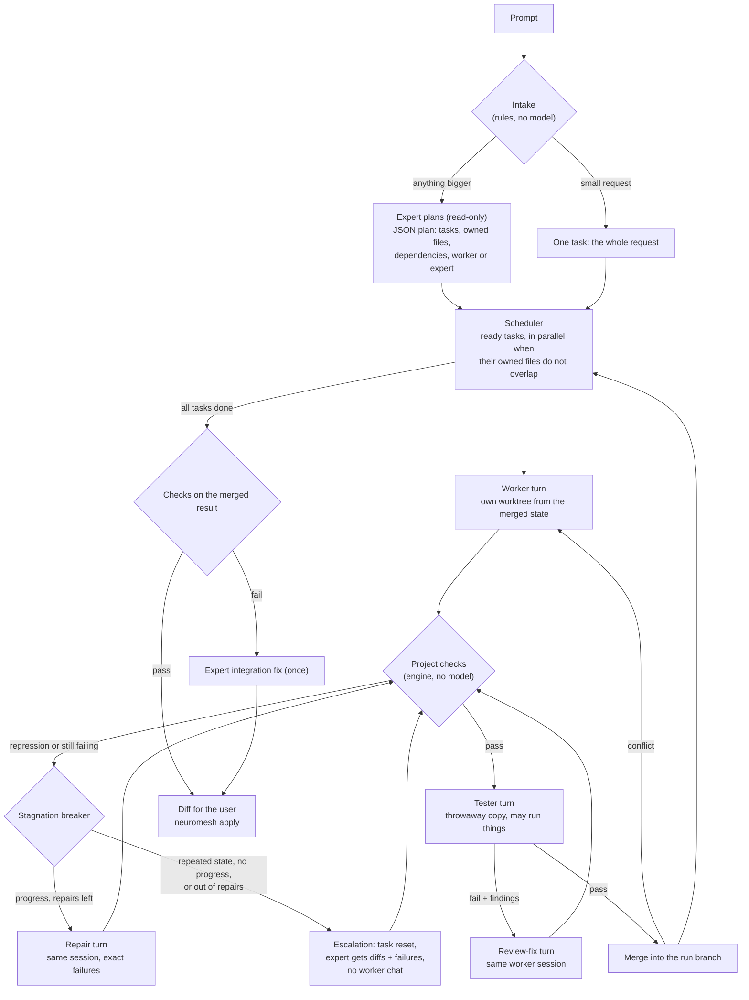

# The engine as built

What the code in `src/` does today. The planning document,
[01-engine-architecture.md](01-engine-architecture.md), explains why; this one
says what. Written 2026-11-11, after M1 to M5 were built.

## The factory floor

## Roles and models

| Role | Who | Sees | Access |
| --- | --- | --- | --- |
| Orchestrator | Expert model | The request, the file list, the checks; reads the repo itself | read-only |
| Worker | Cheap model | Its own task brief only, plus the overall request for context | write, own worktree |
| Tester | Cheap model | The request or task brief and the diff | write, in a throwaway copy whose changes are discarded |
| Escalation | Expert model | The brief, the last two attempted diffs, their exact failures and the reviewer's findings, never the worker's words | write, task worktree reset to its start |

Each role is a list of models. When one runs out of quota (or is no longer
offered, such as the Claude 4.6 models after 18 Nov 2026), the next one takes
over in a fresh session, and the model is put on a cooldown until its reset
time (`~/.neuromesh/cooldowns.json`), so later runs skip it straight away.
When a role has no model left, the run pauses and `neuromesh resume` picks it up.

Default team preset `factory`: expert Claude Opus 4.6 → Sonnet 4.6 (both through
Antigravity) → GPT-6.1 Sol medium (Codex) → Claude Opus 5.5 medium (Claude
Code); worker and tester Gemini 3.8 Flash high (Antigravity).

## Rules the engine applies (no model involved)

- **Task acceptance.** A task may not break a check that passed before the run.
  The last open task must also leave every check passing.
- **Stagnation breaker** (ported from the Rust research, `progress.rs`). After
  each failed check run, the state is fingerprinted as normalised diff, failure
  signatures, failing test names and compile status. A repeated state, or two
  attempts in a row without fewer failures, stops the worker.
- **Escalation limit.** The expert gets one repair turn of its own. If checks
  still fail, the task fails and its work is kept, so the diff can be inspected.
- **Tester limits.** A verdict of "fail" with no concrete finding counts as a
  pass. A tester that errors leaves the checks as the judge.
- **Merge conflicts.** A task whose change conflicts with already merged work is
  redone on top of it, with its earlier diff shown for reference (at most twice).
- **Retries.** A dropped connection or 5xx error is retried once. A session that
  cannot be resumed is replaced by a fresh one with a self-contained prompt.

## Where things are

| Path | What |
| --- | --- |
| `src/engine/run.ts` | The state machine, scheduler, task driver, turns with fallback |
| `src/engine/prompts.ts` | Every prompt and output schema |
| `src/engine/progress.ts` | Stagnation breaker |
| `src/engine/cooldown.ts` | Quota cooldowns across runs |
| `src/intake/intake.ts` | Solo or team, by rules |
| `src/workspace/` | Worktrees, diffs, commits, merges |
| `src/checks/checks.ts` | Finding and running the project's own checks |
| `src/backends/` | Antigravity, Claude Code, Codex adapters; fake backend |
| `src/eval/eval.ts` | Task suite runner |
| `presets/*.json` | Model choices per role |

## Run state

`~/.neuromesh/projects/<repo>-<id>/runs/<run-id>/run.json` holds everything:
step, tasks with their step and history, attempts with usage per role, model
and tier, and the agent turns in progress. It is saved after every step. A
turn in progress when the engine dies is recorded on resume as cancelled with
its usage unknown, and the next turn is told to check the files first.
